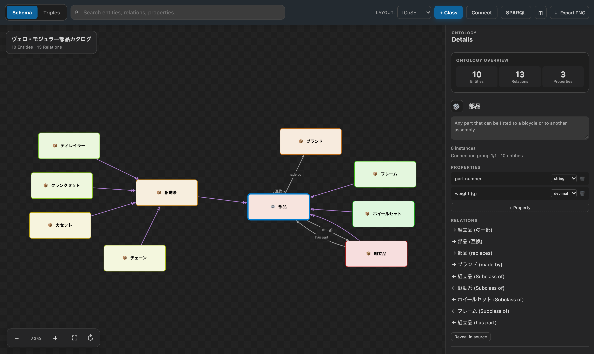
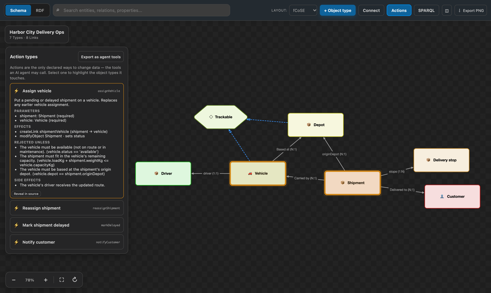
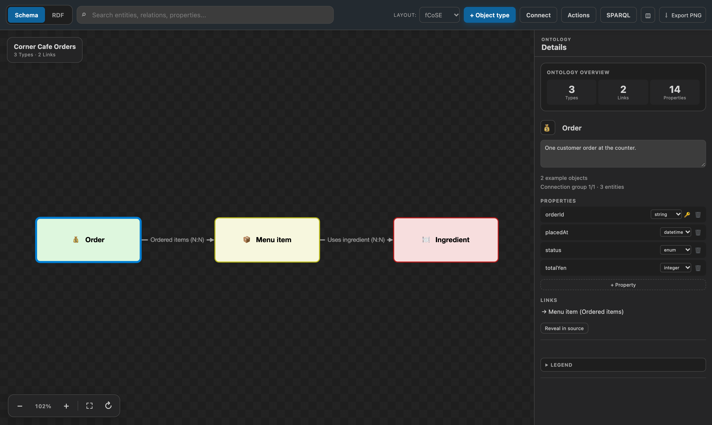
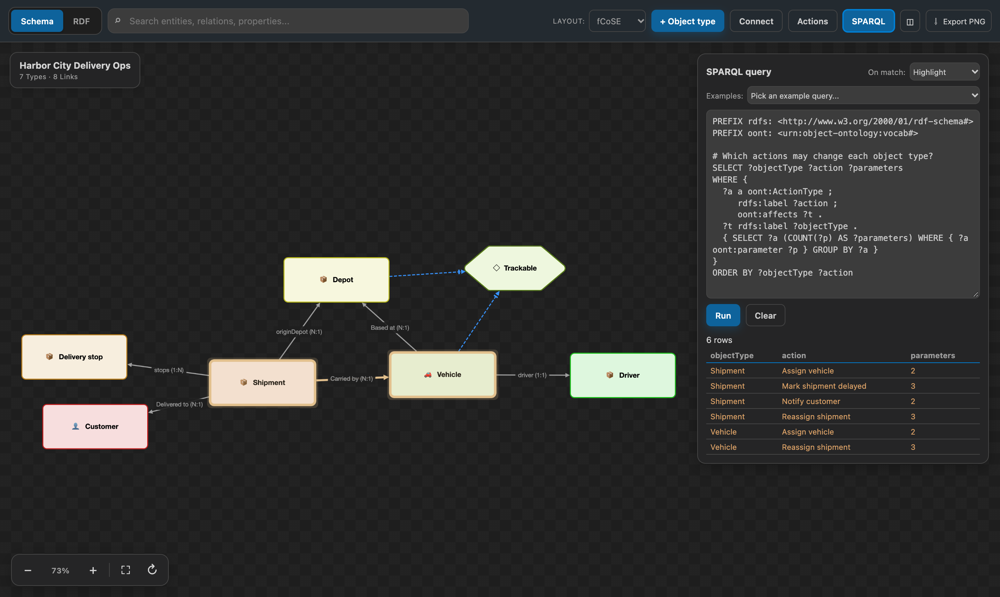

# Ontology Viewer for VS Code

[日本語](README.ja.md)

[](https://github.com/yaggytter/vscode-ontology-viewer/actions/workflows/ci.yml)
[](LICENSE)
[](https://code.visualstudio.com/)

Explore OWL, RDF, RDFS, and SKOS as a readable schema diagram without leaving VS Code. Ontology Viewer combines a polished, searchable canvas with safe Turtle editing, so the diagram is useful for both understanding an ontology and shaping it.

It also reads **Object Ontology** files (`*.oont.yaml`): an object-centric format inspired by the ontologies of operational platforms such as Palantir Foundry, with object types, link types, interfaces, and **action types** that can be exported as tool definitions for AI agents.

> Ontology Viewer is in preview. Keep source control enabled for important ontologies and review diagram-generated changes before committing them.



## Why you will enjoy using it

- **Readable schema cards** keep datatype properties inside their class instead of turning every triple into visual noise.
- **Accessible, meaningful colors** automatically choose readable node text and explain how related entities form color families.
- **A spacious, zoomable canvas** includes zoom in/out, reset to 100%, fit-to-screen, layout switching, and PNG export.
- **Fast navigation** searches classes, relations, and properties. Double-clicking a node focuses its neighborhood.
- **SPARQL queries** run against the open ontology, entirely on your machine, with results shown as text and reflected on the diagram (highlight matches or filter out the rest).
- **An adaptive Inspector** stays beside the graph on wide screens and becomes a dismissible sheet in narrow editor groups.
- **Safe Turtle write-back** re-parses every generated edit before accepting it. Create classes and relations, rename entities, and edit properties or descriptions directly from the diagram.
- **English and Japanese UI** follows the VS Code display language.
- **Local-first operation** sends no ontology contents or usage telemetry from the extension.

## Two styles of ontology, one viewer

| | Semantic Web (OWL / RDF / SKOS) | Object Ontology (`*.oont.yaml`) |
| --- | --- | --- |
| Answers | What things are and how they relate | What the business operates on, and how it may change |
| Identity | Global IRIs, reusable W3C vocabularies | Primary keys inside one system |
| Changes | Not modeled (SPARQL Update is separate) | First-class **action types** with parameters, rules and validations |
| Best AI fit | Grounding answers: GraphRAG, glossaries, provenance | Acting safely: actions become typed agent tools with guard rails |

The [choosing guide](docs/en/choosing-ontology-style.md) and the [use-case catalog](docs/en/use-cases.md) explain when to use which, and how to combine them.

### Object Ontology at a glance



```yaml
objectOntology: 1
name: Corner Cafe Orders
objectTypes:
  Order:
    primaryKey: orderId
    properties:
      orderId: { type: string }
      status: { type: string, enum: [open, preparing, served, cancelled] }
actionTypes:
  markServed:
    parameters:
      order: { type: objectRef, objectType: Order, required: true }
    rules:
      - { op: modifyObject, objectType: Order, object: order, set: { status: served } }
    validations:
      - description: Only an order that is being prepared can be served.
```

- **Diagram, edit, and query** with the same canvas: object types, interfaces (hexagons), link types with cardinality badges, and an **Actions** panel. Diagram edits are surgical YAML changes that are re-parsed before they are applied, and comments are kept.
- **Problems and outline**: broken references, unknown fields, and duplicate example keys are reported at their exact location. A bundled JSON Schema adds completion for `*.oont.json` (and for `*.oont.yaml` with the Red Hat YAML extension).
- **SPARQL** runs over an RDF projection (OWL + an `oont:` vocabulary), with eight Object-Ontology example queries such as "what can be done to each type?" and "follow links between objects".
- **AI-agent exports** open as untitled documents for you to review: action types as **tool definitions** (JSON Schema, the shape used by MCP and function-calling APIs), a compact **LLM context summary** in Markdown, and **Turtle** for combining with Semantic Web data. The extension itself never calls an LLM or the network.



The format is this extension's own; it is not Palantir's file format and does not connect to Foundry.

## Get started in one minute

1. Install **Ontology Viewer** from the VS Code Marketplace.
2. Run **Ontology Viewer: Create Sample Ontology...** from the Command Palette, or open a `.ttl` file.
3. Press `Cmd+Alt+O` on macOS or `Ctrl+Alt+O` on Windows/Linux. You can also use the diagram button in the editor title bar.
4. Select a class to inspect it. Use the floating canvas controls to zoom or fit the graph.
5. For Turtle files, edit the selected class in the Inspector and review the source change in the editor.

Continue with the [Getting Started guide](docs/en/getting-started.md) or the hands-on [tutorials](docs/en/).

## What you can do

### Explore

- Switch between a class-focused **Schema** view and a raw **Triples** view.
- Search and focus entities, inspect incoming and outgoing relations, and see entity/relation/property counts.
- Drag nodes into a useful arrangement; positions are remembered per file and view when you reopen the diagram.
- Choose the organic `fcose` layout or layered `dagre` layout.
- Export the current diagram as PNG or its saved layout as JSON.

### Query with SPARQL

Open the **SPARQL** panel from the toolbar to run SPARQL 1.1 queries against the ontology you have open. SELECT, ASK, and CONSTRUCT/DESCRIBE are supported. Press **Run** or `Ctrl`/`Cmd`+`Enter` to execute.

New to SPARQL? The panel ships nine example queries that work on any ontology, ordered from "show me anything" up through OPTIONAL, FILTER, aggregation, ASK, and CONSTRUCT — pick one and run it. The [SPARQL tutorial](docs/en/tutorial-4-sparql.md) walks through them.

Results show as text — a table of bindings for SELECT, a boolean for ASK, or subject/predicate/object rows for CONSTRUCT — and are reflected on the diagram:

- **Highlight** accents matching nodes and their connecting edges while keeping the rest of the graph visible.
- **Filter** dims everything the query did not match, and composes with the search box and double-click focus.
- **No graph effect** shows the text result only.



Queries execute locally in the extension host (powered by [Comunica](https://comunica.dev/)); no ontology contents leave your machine.

### Edit safely

Turtle files support diagram editing. You can create classes and relations, rename entities, add/rename/retype/delete properties, and edit descriptions. Every write is applied to an in-memory candidate and re-parsed first. If verification fails, the source file is left unchanged.

Text editing remains first-class: Turtle also has outline, hover, completion, and **Rename Symbol (F2)** support.

### Bring existing ontologies

RDF/XML and JSON-LD are viewable directly. Use **Ontology Viewer: Convert to Turtle for Editing...** when you want diagram write-back. The conversion creates a new document and does not overwrite the source file.

## Format support

| Format | Extensions | Diagram | Edit from diagram |
| --- | --- | :---: | :---: |
| Turtle | `.ttl`, `.turtle` | Yes | Yes |
| TriG | `.trig` | Yes | No |
| N-Triples | `.nt` | Yes | No |
| Notation3 | `.n3` | Yes | No |
| RDF/XML / OWL/XML | `.rdf`, `.owl` | Yes | Convert first |
| JSON-LD | `.jsonld` | Yes | Convert first |
| Object Ontology (YAML) | `.oont.yaml`, `.oont.yml` | Yes | Yes |
| Object Ontology (JSON) | `.oont.json` | Yes | Convert to YAML first |

SPARQL querying works on every format in this table — it runs against the parsed triples (or, for Object Ontology files, their RDF projection), so no conversion is needed.

See [Format Support](docs/en/format-support.md) for parser and editing details.

## Commands

| Command | Default keybinding |
| --- | --- |
| Ontology Viewer: Open Diagram Preview | `Cmd+Alt+O` / `Ctrl+Alt+O` |
| Ontology Viewer: Convert to Turtle for Editing... | — |
| Ontology Viewer: Export Diagram Layout as JSON... | — |
| Ontology Viewer: Create Sample Ontology... | — |
| Ontology Viewer: Export Actions as AI Agent Tools (JSON Schema)... | — |
| Ontology Viewer: Export Ontology Summary for LLM Context... | — |
| Ontology Viewer: Export Object Ontology as Turtle (OWL)... | — |
| Ontology Viewer: Convert Object Ontology JSON to YAML for Editing... | — |

`Cmd+Shift+O` / `Ctrl+Shift+O` remains VS Code's built-in **Go to Symbol in Editor** command.

## Settings

| Setting | Default | Description |
| --- | --- | --- |
| `ontologyViewer.preview.autoRefreshDebounceMs` | `300` | Delay in milliseconds before a source edit refreshes the diagram. |
| `ontologyViewer.preview.defaultView` | `schema` | Initial view: `schema` or `triples`. |
| `ontologyViewer.preview.layout` | `fcose` | Automatic layout: `fcose` or `dagre`. |

## Documentation and help

- [Getting Started](docs/en/getting-started.md)
- [Build Your First Ontology](docs/en/tutorial-1-first-ontology.md)
- [Edit From the Diagram](docs/en/tutorial-2-editing-from-diagram.md)
- [Import an Existing OWL File](docs/en/tutorial-3-importing-owl.md)
- [Ask Questions with SPARQL](docs/en/tutorial-4-sparql.md)
- [Your First Object Ontology](docs/en/tutorial-5-object-ontology.md)
- [Object Ontology × AI Agents](docs/en/tutorial-6-object-ontology-ai-agents.md)
- [Semantic Web Ontologies × LLMs](docs/en/tutorial-7-semantic-web-llm.md)
- [Choosing an Ontology Style](docs/en/choosing-ontology-style.md) · [Use Cases](docs/en/use-cases.md)
- [Format Support](docs/en/format-support.md)
- [Troubleshooting](docs/en/troubleshooting.md)
- [Support](SUPPORT.md) · [Privacy](PRIVACY.md) · [Security](SECURITY.md)
- [Contributing](CONTRIBUTING.md) · [Changelog](CHANGELOG.md)

Before opening an issue, check the [troubleshooting guide](docs/en/troubleshooting.md). Bugs and focused feature requests are welcome in [GitHub Issues](https://github.com/yaggytter/vscode-ontology-viewer/issues).

## Privacy and trust

Ontology Viewer processes ontology documents locally in the VS Code extension host and webview. The extension does not include telemetry, advertising, accounts, or an extension-owned network service. See the [Privacy Notice](PRIVACY.md) for the exact data flow and the [Security Policy](SECURITY.md) for reporting vulnerabilities.

## License

Released under the [MIT License](LICENSE). Bundled dependency notices are listed in [THIRD_PARTY_NOTICES.md](THIRD_PARTY_NOTICES.md).
