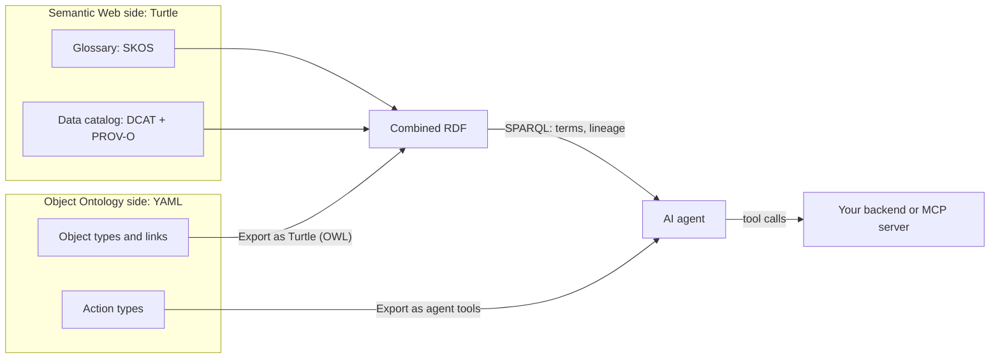

# Choosing an Ontology Style

Ontology Viewer works with two kinds of ontology. **Object Ontology** (`*.oont.yaml`) is this extension's own format, inspired by Palantir Foundry's ontology: object types, properties, link types, interfaces, and *action types*. **Semantic Web** ontologies (OWL/RDF in Turtle, RDF/XML and other formats) are the W3C standard. This guide explains how they differ, shows the same domain written both ways, and helps you decide which to use — or how to use both.

## 1. The core difference

An Object Ontology answers the question **"what do we operate on, and what are we allowed to do to it?"** It describes business objects with primary keys, the links between them, and the actions that change them, each with typed parameters, preconditions and side effects. A Semantic Web ontology answers **"what are things, and how do they relate?"** It describes classes, properties and individuals with globally unique IRIs, so that facts from different sources can be joined, reused and reasoned over. The first is built around *doing*; the second around *knowing*.

## 2. Side by side

| | Object Ontology | Semantic Web (OWL/RDF) |
| --- | --- | --- |
| Central question | What do we operate on? | What exists, and how is it related? |
| Identity | A primary key per object type, unique within your system (`V-102`) | A global IRI, unique across organizations (`https://example.org/delivery-ops#V-102`) |
| World assumption | Closed: what is not defined does not exist. Unknown fields and broken references are reported in the Problems panel | Open: a missing fact is unknown, not false. A query that finds nothing does not prove a negative |
| Changes | Action types are first-class: parameters, rules (create/modify/delete objects and links), validations, side effects | No standard notion of actions. Changes are made separately, for example with SPARQL Update |
| Standardization | Vendor-specific (here: this extension's own format) | W3C standards, with reusable vocabularies such as schema.org, SKOS, DCAT and PROV-O |
| Learning curve | Low for application developers: types, keys, foreign keys, YAML | Higher: IRIs, triples, prefixes, open-world semantics |
| Reasoning | None. Behavior lives in actions and in whatever backend executes them | RDFS/OWL reasoners can derive new facts (an external tool; this viewer does not run one) |
| LLM/agent fit | **Action and tool use.** Actions export as tool definitions with typed arguments; validations describe when a call must be rejected | **Knowledge and grounding.** GraphRAG, provenance, multilingual terminology, data integration |
| Typical uses | Operations, decision-and-execute workflows, internal apps | Research data integration, data catalogs, standard vocabularies in regulated fields, cross-organization exchange |

## 3. The same domain, both ways

The bundled samples model one last-mile delivery business twice, with the same IDs: [`delivery-ops.oont.yaml`](../../samples/delivery-ops.oont.yaml) and [`delivery-ops.ttl`](../../samples/delivery-ops.ttl). In both, shipment S-5001 is delayed because van V-101 is in maintenance, and van V-102 at the same depot has room.

### Object Ontology excerpt

```yaml
objectTypes:
  Vehicle:
    description: A delivery van, truck or cargo bike.
    primaryKey: vehicleId
    titleProperty: plate
    implements: [Trackable]
    properties:
      # ... plate, kind, depotId, lat, lon omitted
      vehicleId: { type: string }
      status: { type: string, enum: [available, onRoute, maintenance] }
      capacityKg: { type: double, unit: kg }
      loadKg: { type: double, unit: kg, description: "Weight already assigned to this vehicle." }

actionTypes:
  assignVehicle:
    displayName: Assign vehicle
    description: Put a pending or delayed shipment on a vehicle. Replaces any earlier vehicle assignment.
    parameters:
      shipment: { type: objectRef, objectType: Shipment, required: true }
      vehicle: { type: objectRef, objectType: Vehicle, required: true }
    rules:
      - { op: createLink, linkType: shipmentVehicle, from: shipment, to: vehicle }
      - { op: modifyObject, objectType: Shipment, object: shipment, set: { status: assigned } }
    validations:
      - description: The vehicle must be available (not on route or in maintenance).
        expr: "vehicle.status == 'available'"
      - description: The shipment must fit in the vehicle's remaining capacity.
        expr: "vehicle.loadKg + shipment.weightKg <= vehicle.capacityKg"
      - description: The vehicle must be based at the shipment's origin depot.
        expr: "vehicle.depot == shipment.originDepot"
    sideEffects:
      - The vehicle's driver receives the updated route.
```

### OWL excerpt

```turtle
:Vehicle a owl:Class ; rdfs:subClassOf :Trackable ; rdfs:label "Vehicle"@en, "車両"@ja .
:carriedBy a owl:ObjectProperty, owl:FunctionalProperty ; rdfs:label "carried by"@en ;
  rdfs:domain :Shipment ; rdfs:range :Vehicle .
:carries a owl:ObjectProperty ; rdfs:label "carries"@en ; owl:inverseOf :carriedBy .
:vehicleStatus a owl:ObjectProperty, owl:FunctionalProperty ; rdfs:label "vehicle status"@en ;
  rdfs:domain :Vehicle ; rdfs:range :VehicleStatus .
:capacityKg a owl:DatatypeProperty, owl:FunctionalProperty ; rdfs:label "capacity (kg)"@en ; rdfs:domain :Vehicle ; rdfs:range xsd:double .

:V-102 a :Vehicle ; :identifier "V-102" ; :plate "HC-102" ; :vehicleStatus :available ;
  :capacityKg 1000.0e0 ; :loadKg 350.0e0 ; :basedAt :D-01 ; :drivenBy :DR-02 ; :lat 35.4524e0 ; :lon 139.6398e0 .
```

### What each can and cannot express

The YAML says what an agent **may do**: `assignVehicle` takes a shipment and a vehicle, creates one link and sets one field, and must be refused if the vehicle is not available, lacks capacity, or is based elsewhere. Run **Export Actions as AI Agent Tools (JSON Schema)...** and that becomes a tool definition. What the YAML does not give you is a global identity for V-102, a way to say that "carried by" and "carries" are inverses for other tools to use, or a standard vocabulary another company already understands.

The Turtle says what **is the case**, in terms any RDF tool can read: V-102 is a Vehicle, `:carriedBy` has an inverse `:carries`, labels exist in English and Japanese. It can answer "which available vehicle at D-01 has spare capacity?" with SPARQL. It cannot say that reassigning a shipment is an allowed operation, which parameters it takes, or that the customer must be notified afterwards. OWL states facts; it has no first-class actions.

Neither side enforces rules inside the viewer. The Object Ontology's `expr` strings are documentation for people and agents; the extension does not evaluate them, and your MCP server or backend must check them when it executes a tool call. On the OWL side, `owl:FunctionalProperty` on `:carriedBy` does not reject a second vehicle either: under OWL semantics a reasoner would conclude that the two vehicles are the same individual, and this viewer runs no reasoner at all.

## 4. Decision checklist

Answer the questions in order. The first strong "yes" usually decides.

| Question | If yes |
| --- | --- |
| Will an AI agent or app **change** records (assign, refund, close, reserve)? | Object Ontology for those operations. Actions become tools with typed arguments and documented preconditions |
| Must the data be **joined with other organizations'** data, or survive system migrations? | Semantic Web. Global IRIs and `sameAs` links are designed for this |
| Is there an established **standard vocabulary** in your field (SKOS thesauri, DCAT catalogs, schema.org)? | Semantic Web, reusing that vocabulary rather than inventing one |
| Do answers need **provenance**, licenses, or multilingual terminology? | Semantic Web (PROV-O, DCAT, SKOS) |
| Is the main consumer an **internal team of application developers** who know tables and keys? | Object Ontology. The learning curve is lower |
| Do you need **inference** (subclass and transitive closure, consistency checks)? | Semantic Web with an external reasoner, or explicit property paths in SPARQL |
| Two or more of the above point in different directions? | Hybrid (next section) |

## 5. Hybrid architecture

Many real systems need both: shared knowledge that outlives any one application, and an operational model that agents can act on. A practical split looks like this.



- The **glossary** (SKOS) and **data catalog** (DCAT + PROV-O) stay on the Semantic Web side, where other teams and tools can reuse them.
- The **operations** are an Object Ontology. Agents write only through its actions, and your backend enforces the validations.
- **Export Object Ontology as Turtle (OWL)...** is the bridge. The exported Turtle uses OWL plus the `oont:` vocabulary, so it can sit next to the glossary in one RDF store and be queried with one SPARQL query. The viewer itself queries one document at a time, so combine the files first; [Tutorial 7](tutorial-7-semantic-web-llm.md) section 6 shows how, with a tested query.

## 6. Common misconceptions

**"An Object Ontology is just a database schema."** A schema describes tables and columns. An Object Ontology also defines actions (what may change, with which parameters), validations (when a change must be refused), side effects, and interfaces shared across types. That extra layer is what makes it useful as an agent's tool list.

**"The Semantic Web is outdated."** Its standards are stable and widely used where interoperability matters: library and research data, public-sector data catalogs, and many domain vocabularies. Global identifiers, provenance and multilingual labels are exactly what LLM answers often lack.

**"Pick one and convert later."** Conversion is one-way in this extension: an Object Ontology can be exported to Turtle, but actions have no OWL counterpart, so they are exported as descriptions in the `oont:` vocabulary that OWL tools read as plain data. Decide early which side owns which part of the model.

**"OWL constraints will stop bad data."** Not by themselves. OWL is open-world; a reasoner draws conclusions from constraints rather than rejecting data, and nothing is checked in this viewer. Validation belongs in the system that writes the data, on either side.

## 7. Market context

Several data platforms now ship an ontology-like layer of entities, properties and relationships for BI and AI agents: Palantir Foundry's Ontology, the ontology in Microsoft Fabric IQ (in preview), Snowflake semantic views, and the dbt Semantic Layer. Each is defined and executed inside its own platform. This extension's Object Ontology format is its own, inspired by Palantir's concepts; it is not compatible with any of these products. Its purpose is to let you design, review and query an operational ontology as a plain file next to your code.

## Next steps

- [Tutorial 5: Your First Object Ontology](tutorial-5-object-ontology.md) — create, view and edit an Object Ontology.
- [Tutorial 6: Object Ontology × AI Agents](tutorial-6-object-ontology-ai-agents.md) — actions as agent tools, using the delivery delay scenario.
- [Tutorial 7: Semantic Web Ontologies × LLMs](tutorial-7-semantic-web-llm.md) — grounding, LLM-written SPARQL, glossaries and provenance.
- [Use Cases](use-cases.md) — business scenarios mapped to a style and a sample.
