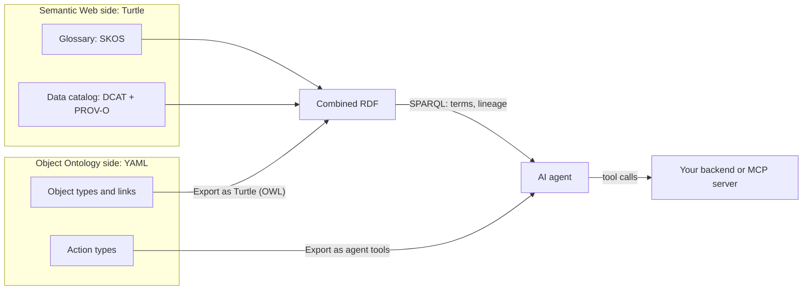

# オントロジー方式の選び方

Ontology Viewer は2種類のオントロジーを扱います。**Object Ontology**（`*.oont.yaml`）は、Palantir Foundry のオントロジーに着想を得たこの拡張機能独自の形式で、オブジェクト型、プロパティ、リンク型、インターフェース、そして**アクション型**で構成されます。**Semantic Web** のオントロジー（Turtle や RDF/XML などで書く OWL/RDF）は W3C の標準です。このガイドでは両者の違いを説明し、同じ題材を両方の方式で書いた例を示したうえで、どちらを使うか、あるいはどう併用するかを判断する手がかりを示します。

## 1. いちばん大きな違い

Object Ontology が答えるのは「**業務で何を操作し、それに対して何をしてよいか**」という問いです。主キーを持つ業務オブジェクト、オブジェクト間のリンク、そしてオブジェクトを変更するアクションを記述します。アクションには型付きのパラメーター、実行条件、副作用が付きます。Semantic Web のオントロジーが答えるのは「**物事が何であり、互いにどう関係するか**」という問いです。クラス、プロパティ、個体を世界で一意な IRI で記述するので、異なる情報源の事実を結合し、再利用し、推論の材料にできます。前者は「行うこと」を、後者は「知ること」を中心に組み立てられています。

## 2. 比較表

| | Object Ontology | Semantic Web（OWL/RDF） |
| --- | --- | --- |
| 中心にある問い | 業務で何を操作するか | 何が存在し、どう関係するか |
| 識別子 | オブジェクト型ごとの主キー。システム内で一意（`V-102`） | グローバルな IRI。組織をまたいで一意（`https://example.org/delivery-ops#V-102`） |
| 世界の前提 | 閉世界。定義されていないものは存在しない。未知のフィールドや壊れた参照は問題パネルに表示される | 開世界。書かれていない事実は「不明」であって「偽」ではない。何も見つからないクエリは否定の証明にならない |
| 変更操作 | アクション型が第一級。パラメーター、ルール（オブジェクトとリンクの作成・変更・削除）、検証、副作用を定義する | 標準のアクションの仕組みはない。変更は SPARQL Update などで別に行う |
| 標準化 | ベンダー独自（ここではこの拡張機能独自の形式） | W3C 標準。schema.org、SKOS、DCAT、PROV-O などの語彙を再利用できる |
| 学習コスト | アプリ開発者には低い。型、キー、外部キー、YAML | 高め。IRI、トリプル、プレフィックス、開世界の意味論 |
| 推論 | なし。振る舞いはアクションと、それを実行するバックエンドが担う | RDFS/OWL の推論器で新しい事実を導ける（外部ツール。このビューワーには推論器はない） |
| LLM・エージェントとの相性 | **行動とツール利用**。アクションは型付き引数を持つツール定義としてエクスポートでき、検証は呼び出しを拒否すべき条件を示す | **知識と裏付け**。GraphRAG、来歴、多言語の用語、データ統合 |
| 主な用途 | 業務オペレーション、意思決定と実行、社内アプリ | 研究データの統合、データカタログ、規制分野の標準語彙、組織間のデータ連携 |

## 3. 同じ題材を両方の方式で書く

同梱のサンプルには、同じラストワンマイル配送の業務を同じ ID で2通りに書いたものがあります。[`delivery-ops.oont.yaml`](../../samples/delivery-ops.oont.yaml) と [`delivery-ops.ttl`](../../samples/delivery-ops.ttl) です。どちらでも、配送 S-5001 はバン V-101 の整備のため遅れており、同じ営業所のバン V-102 には空きがあります。

### Object Ontology の抜粋

```yaml
objectTypes:
  Vehicle:
    description: A delivery van, truck or cargo bike.
    primaryKey: vehicleId
    titleProperty: plate
    implements: [Trackable]
    properties:
      # ... plate, kind, depotId, lat, lon omitted
      vehicleId: { type: string }
      status: { type: string, enum: [available, onRoute, maintenance] }
      capacityKg: { type: double, unit: kg }
      loadKg: { type: double, unit: kg, description: "Weight already assigned to this vehicle." }

actionTypes:
  assignVehicle:
    displayName: Assign vehicle
    description: Put a pending or delayed shipment on a vehicle. Replaces any earlier vehicle assignment.
    parameters:
      shipment: { type: objectRef, objectType: Shipment, required: true }
      vehicle: { type: objectRef, objectType: Vehicle, required: true }
    rules:
      - { op: createLink, linkType: shipmentVehicle, from: shipment, to: vehicle }
      - { op: modifyObject, objectType: Shipment, object: shipment, set: { status: assigned } }
    validations:
      - description: The vehicle must be available (not on route or in maintenance).
        expr: "vehicle.status == 'available'"
      - description: The shipment must fit in the vehicle's remaining capacity.
        expr: "vehicle.loadKg + shipment.weightKg <= vehicle.capacityKg"
      - description: The vehicle must be based at the shipment's origin depot.
        expr: "vehicle.depot == shipment.originDepot"
    sideEffects:
      - The vehicle's driver receives the updated route.
```

### OWL の抜粋

```turtle
:Vehicle a owl:Class ; rdfs:subClassOf :Trackable ; rdfs:label "Vehicle"@en, "車両"@ja .
:carriedBy a owl:ObjectProperty, owl:FunctionalProperty ; rdfs:label "carried by"@en ;
  rdfs:domain :Shipment ; rdfs:range :Vehicle .
:carries a owl:ObjectProperty ; rdfs:label "carries"@en ; owl:inverseOf :carriedBy .
:vehicleStatus a owl:ObjectProperty, owl:FunctionalProperty ; rdfs:label "vehicle status"@en ;
  rdfs:domain :Vehicle ; rdfs:range :VehicleStatus .
:capacityKg a owl:DatatypeProperty, owl:FunctionalProperty ; rdfs:label "capacity (kg)"@en ; rdfs:domain :Vehicle ; rdfs:range xsd:double .

:V-102 a :Vehicle ; :identifier "V-102" ; :plate "HC-102" ; :vehicleStatus :available ;
  :capacityKg 1000.0e0 ; :loadKg 350.0e0 ; :basedAt :D-01 ; :drivenBy :DR-02 ; :lat 35.4524e0 ; :lon 139.6398e0 .
```

### それぞれが表せること、表せないこと

YAML が表しているのは、エージェントが**してよいこと**です。`assignVehicle` は配送と車両を受け取り、リンクを1つ作ってフィールドを1つ更新します。車両が空いていない、積載量が足りない、別の営業所の所属である、のいずれかに当たれば拒否しなければなりません。**「アクションを AI エージェント用ツール定義 (JSON Schema) としてエクスポート...」** を実行すれば、これがそのままツール定義になります。一方、YAML では V-102 に世界で通用する識別子を与えることはできません。「carried by」と「carries」が逆の関係であることを他のツールが使える形で書くことも、他社がすでに理解している標準語彙で書くこともできません。

Turtle が表しているのは**事実**で、RDF のツールならどれでも読めます。V-102 は Vehicle であり、`:carriedBy` には逆プロパティ `:carries` があり、ラベルは英語と日本語の両方で付いています。「D-01 にいて空きのある車両はどれか」には SPARQL で答えられます。しかし、配送の付け替えが許された操作であることも、その操作がどんなパラメーターを取るかも、終わったら顧客に知らせる必要があることも書けません。OWL は事実を述べるもので、アクションを第一級で扱う仕組みはありません。

どちらの方式でも、ビューワーの中でルールが強制されることはありません。Object Ontology の `expr` は人とエージェントのための説明で、拡張機能はこれを評価しません。ツール呼び出しを実行する MCP サーバーやバックエンドが確認する必要があります。OWL 側でも、`:carriedBy` に付けた `owl:FunctionalProperty` は2台目の車両を拒否しません。OWL の意味論では、推論器は「その2台は同じ個体である」と結論づけます。そもそもこのビューワーは推論器を動かしません。

## 4. 判断のためのチェックリスト

上から順に答えてください。最初にはっきり「はい」となった項目で、たいてい方針が決まります。

| 質問 | 「はい」なら |
| --- | --- |
| AI エージェントやアプリがレコードを**変更**するか（割り当て、返金、完了、予約など） | その操作は Object Ontology で。アクションが、型付き引数と実行条件の説明を持つツールになる |
| 他組織のデータと**結合**する必要があるか。システム移行後も識別子を保ちたいか | Semantic Web。グローバルな IRI と `sameAs` リンクはこのためにある |
| 分野に定着した**標準語彙**があるか（SKOS のシソーラス、DCAT のカタログ、schema.org など） | Semantic Web。語彙を自作せず、既存の語彙を再利用する |
| 回答に**来歴**、ライセンス、多言語の用語が必要か | Semantic Web（PROV-O、DCAT、SKOS） |
| 主な利用者は、テーブルとキーに慣れた**社内のアプリ開発者**か | Object Ontology。学習コストが低い |
| **推論**（サブクラスや推移関係の閉包、整合性チェック）が必要か | Semantic Web と外部の推論器。または SPARQL のプロパティパスで明示的に書く |
| 上の項目のうち2つ以上が別々の方向を指しているか | ハイブリッド（次章） |

## 5. ハイブリッド構成

実際のシステムでは、両方が必要になることがよくあります。特定のアプリより長く使われる共有の知識と、エージェントが操作できる業務モデルの両方です。現実的な分担は次のようになります。



- **用語集**（SKOS）と**データカタログ**（DCAT + PROV-O）は Semantic Web 側に置きます。他のチームやツールもそのまま再利用できます。
- **業務オペレーション**は Object Ontology で定義します。エージェントが書き込めるのはアクション経由だけにし、検証はバックエンドで行います。
- 両者をつなぐのが **「Object Ontology を Turtle (OWL) としてエクスポート...」** です。エクスポートした Turtle は OWL と `oont:` 語彙で書かれているので、用語集と同じ RDF ストアに置き、1つの SPARQL クエリで横断できます。ビューワー自体は一度に1つのドキュメントしか問い合わせないため、先にファイルを1つにまとめます。手順と検証済みのクエリは [チュートリアル7](tutorial-7-semantic-web-llm.md) の6章にあります。

## 6. よくある誤解

**「Object Ontology はただのデータベーススキーマだ」** スキーマが記述するのはテーブルと列です。Object Ontology はそれに加えて、アクション（何を、どのパラメーターで変更してよいか）、検証（どんなときに変更を拒否すべきか）、副作用、型をまたいで共有するインターフェースを定義します。この層があるからこそ、エージェントのツール一覧として役に立ちます。

**「Semantic Web は時代遅れだ」** 標準は安定しており、相互運用性が重要な分野で広く使われています。図書館や研究のデータ、公共機関のデータカタログ、多くの分野別語彙がその例です。グローバルな識別子、来歴、多言語のラベルは、まさに LLM の回答に欠けがちなものです。

**「とりあえず片方を選んで、あとで変換すればよい」** この拡張機能での変換は一方向です。Object Ontology は Turtle にエクスポートできますが、アクションには OWL での対応物がありません。そのため、アクションは `oont:` 語彙による記述として出力され、OWL のツールからは単なるデータとして読まれます。モデルのどの部分をどちらの方式で持つかは、早めに決めてください。

**「OWL の制約で不正なデータを防げる」** それだけでは防げません。OWL は開世界で、推論器は制約からデータを拒否するのではなく結論を導きます。また、このビューワーでは何もチェックされません。検証は、どちらの方式でも、データを書き込むシステムの側で行うものです。

## 7. 市場の動向

BI や AI エージェント向けに、エンティティ・プロパティ・関係からなるオントロジー的な層を提供するデータ基盤が増えています。Palantir Foundry の Ontology、Microsoft Fabric IQ のオントロジー（プレビュー）、Snowflake のセマンティックビュー、dbt Semantic Layer などです。いずれもそれぞれのプラットフォームの中で定義・実行されるものです。この拡張機能の Object Ontology 形式は、Palantir の考え方に着想を得た独自の形式で、これらの製品のいずれとも互換性はありません。目的は、業務オントロジーをコードの隣に置けるプレーンなファイルとして設計し、レビューし、問い合わせられるようにすることです。

## 次のステップ

- [チュートリアル5: はじめての Object Ontology](tutorial-5-object-ontology.md) — Object Ontology の作成、表示、編集。
- [チュートリアル6: Object Ontology × AI エージェント](tutorial-6-object-ontology-ai-agents.md) — 配送遅延のシナリオで、アクションをエージェントのツールとして使う。
- [チュートリアル7: Semantic Web オントロジー × LLM](tutorial-7-semantic-web-llm.md) — 回答の裏付け、LLM が書く SPARQL、用語集、来歴。
- [ユースケース集](use-cases.md) — 業務シナリオごとの方式とサンプル。
